---

## 👋 Olá, eu sou o Erick!

Sou **Assistente de Auditoria na PharmaScience** e estudante do **4º período de Ciência da Computação** no Centro Universitário UNA – Barreiro. No dia a dia, trabalho com análise de dados operacionais, relatórios gerenciais e **KPIs**, usando **Excel Avançado e Power BI** para apoiar decisões. Meu objetivo é crescer na área de **Dados & Business Intelligence**.

- 📊 Criando dashboards e acompanhando indicadores de desempenho
- 🔍 Identificando inconsistências e estruturando dados de múltiplas áreas
- 🐍 Aprendendo **Python** para ampliar minha caixa de ferramentas em dados
- 📍 Ibirité – MG

---

## 📈 Meu dashboard

  

---

## 🛠️ Ferramentas e tecnologias

**Dados & BI**

  

**Desenvolvimento**

---

## 🧭 Explore (clique para expandir)

<b>💼 Experiência profissional</b>

 

**Assistente de Auditoria — PharmaScience** *(Out/2026 – atual)*
- Análise de dados operacionais em Excel e Power BI para apoiar auditorias internas
- Relatórios gerenciais consolidando informações de várias áreas
- Tabelas dinâmicas, gráficos e painéis interativos para acompanhar KPIs
- Monitoramento recorrente de indicadores de desempenho

**Auxiliar de Auditoria — PharmaScience** *(Jan/2026 – Out/2026)*
- Promovido a Assistente de Auditoria em outubro de 2026

<b>🎓 Formação e cursos</b>

 

- **Bacharelado em Ciência da Computação** — UNA Barreiro (4º período, em andamento)
- Programação e Soluções Computacionais — 160h
- Modelagem de Software — 160h

<b>🚀 Projetos e estudos</b>

 

- Dashboards de indicadores em Power BI
- Organização, tratamento e automação de rotinas em Excel Avançado
- Sistemas orientados a objetos em Java
- Testes unitários e Conventional Commits em projetos acadêmicos

---

## 📊 Estatísticas do GitHub

---

## 🐍 Contribuições

 

---

## 📬 Vamos conversar?

  

